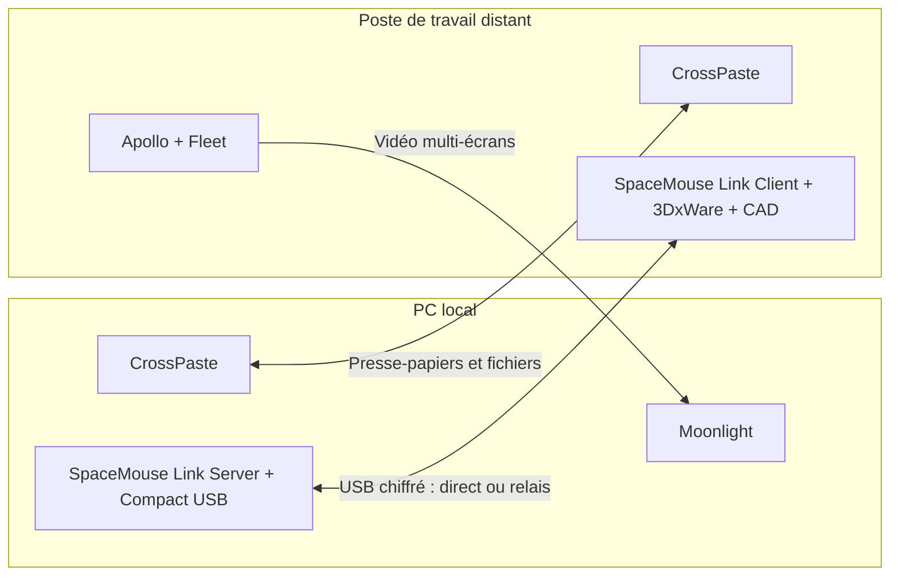

# Apollo Desktop Kit

**Votre poste de travail à distance : plusieurs écrans, un presse-papiers partagé et votre SpaceMouse.**

Quatre composants séparés pour préparer le poste Apollo, lancer les écrans Moonlight, synchroniser le presse-papiers avec CrossPaste et transmettre une SpaceMouse Compact USB. Choisissez les composants utiles : **SpaceMouse Link fonctionne aussi avec Parsec, sans installer Apollo ou Moonlight.**

## Télécharger

| Besoin | Téléchargement | Où l'installer |
|---|---|---|
| Client Moonlight et scripts multi-écrans | [Apollo-Setup.cmd · v0.2.3](https://github.com/softyoda/apollo-desktop-kit/releases/download/v0.2.3/Apollo-Setup.cmd) | PC depuis lequel vous travaillez |
| Partager la SpaceMouse physique | [SpaceMouse Link **Server** · 0.2.0-beta.2](https://github.com/softyoda/apollo-desktop-kit/releases/download/spacemouse-v0.2.0-beta.2/SpaceMouseLink-Server-0.2.0-beta.2-x64.exe) | PC où la SpaceMouse est branchée |
| Recevoir la SpaceMouse dans le CAD | [SpaceMouse Link **Client** · 0.2.0-beta.2](https://github.com/softyoda/apollo-desktop-kit/releases/download/spacemouse-v0.2.0-beta.2/SpaceMouseLink-Client-0.2.0-beta.2-x64.exe) | Poste distant qui exécute le CAD |

SpaceMouse Link est une **bêta Windows x64**, pour la **3Dconnexion SpaceMouse Compact USB**. Installez un rôle sur chaque poste. Consultez les [notes de version et SHA-256](https://github.com/softyoda/apollo-desktop-kit/releases/tag/spacemouse-v0.2.0-beta.2).

**Correctif 0.2.0-beta.2 :** corrige le refus d'accès lors du contrôle du pare-feu Server sans élévation. Voir la [validation du correctif](components/spacemouse/VALIDATION.md).

## Vous utilisez déjà Parsec ou Moonlight ?


Installez uniquement **SpaceMouse Link** pour utiliser votre Compact et ses boutons sur le poste distant, avec 3DxWare et les profils de vos logiciels.

1. Installez **Server** sur le PC avec la SpaceMouse et **Client** sur le poste CAD. L'étape **USB prerequisite**, optionnelle et décochée par défaut, installe/configure les pilotes nécessaires avec une autorisation administrateur.
2. Sur Server, sélectionnez la Compact puis **Prepare USB device**. Sur Client, installez/configurez **3DxWare**.
3. Sur Server, ouvrez **Pairing → Create invitation → Copy invitation**. Transmettez l'invitation par un canal de confiance et collez-la dans **Pairing** sur Client. Elle expire après cinq minutes.
4. Cliquez **Pair with server**, comparez le code sur **les deux écrans**, puis approuvez des deux côtés uniquement si les codes correspondent.
5. Cliquez **Connect** sur les deux postes. Vérifiez la navigation et les boutons dans 3Dconnexion Trainer, puis dans votre logiciel.

**Au quotidien :** l'icône dans la zone de notification permet d'ouvrir, connecter, déconnecter ou quitter l'application. Les préférences proposent le démarrage avec Windows, la connexion automatique au dernier partenaire approuvé et le maintien en arrière-plan quand la fenêtre est fermée. Un désinstallateur est fourni. L'application s'exécute sans droits administrateur.

Le tunnel privilégie une connexion **DIRECT** chiffrée et utilise un **RELAY** chiffré si le réseau empêche la connexion directe. SpaceMouse Link ne nécessite ni VPN ni redirection manuelle de ports sur la box. Des services publics de rendez-vous et de découverte interviennent dans l'établissement de la connexion. Le transport et son RTT sont affichés ; ce RTT ne mesure pas le délai complet entre votre geste et l'image du logiciel distant.

→ [Installation, appairage, préférences et désinstallation de SpaceMouse Link](components/spacemouse/README.md)

## Vous souhaitez installer le bureau multi-écrans ?

1. **Préparez le poste Windows distant.** Depuis les sources du dépôt, lancez `Install-host.cmd` et suivez le [guide Apollo Server](docs/windows-host.md) pour Apollo, Fleet et les écrans.
2. **Préparez votre PC Windows local.** Téléchargez puis lancez `Apollo-Setup.cmd`. L'assistant installe les applications nécessaires, prépare le profil d'écrans et crée le raccourci de lancement.
3. **Associez les applications.** Associez chaque instance Apollo dans Moonlight, renseignez les noms des hôtes dans le profil et associez les deux PC dans CrossPaste pour le presse-papiers.
4. **Lancez votre bureau.** Le raccourci ouvre un flux Moonlight par écran avec les résolutions et placements du profil.

Pour Linux, suivez le [guide client Linux](docs/linux-client.md). Pour adapter les résolutions ou distribuer un lanceur préconfiguré, consultez le [montage de référence](docs/reference-setup.md) et le [profil à deux écrans](examples/two-screens.json).

Les flux affichent **le même bureau Windows étendu**, pas des sessions utilisateurs indépendantes. Apollo/Moonlight et CrossPaste utilisent leur propre connexion : le parcours documenté repose sur le LAN ou un VPN autorisé. Le tunnel SpaceMouse ne transporte ni la vidéo ni le presse-papiers. Voir le [guide réseau](docs/network.md).

## Quel composant va sur quel PC ?

| Composant | PC local, devant vous | Poste de travail distant | Sources |
|---|---|---|---|
| **Apollo Server** | — | Hôte vidéo, Fleet, écrans et résolutions | [apollo-server](components/apollo-server) |
| **Moonlight scripts** | Client vidéo, profils et placement des fenêtres | — | [moonlight](components/moonlight) |
| **Clipboard** | CrossPaste | CrossPaste | [clipboard](components/clipboard) |
| **SpaceMouse Link** | **Server USB**, avec la Compact branchée | **Client USB**, avec le CAD et 3DxWare | [spacemouse](components/spacemouse) |

Les rôles **Server/Client de SpaceMouse désignent le sens du partage USB** : ils sont indépendants des rôles du streaming vidéo.



## Sécurité et limites de SpaceMouse Link

Les installateurs publics ne contiennent aucune clé d'appairage. Une identité est créée localement ; après vérification sur les deux écrans, chaque profil n'accepte que la clé du partenaire enregistré. Les secrets sont protégés par Windows DPAPI pour le compte utilisateur courant. **Forget trusted peer** permet de révoquer l'association.

L'étape USB optionnelle vérifie le hash et la signature des installateurs officiels et bloque les accès réseau non locaux au port USB TCP 3240 sur Server. Les pilotes et cette protection restent installés après désinstallation de l'application. Aucun redémarrage automatique n'est effectué ; le pilote Client peut nécessiter un redémarrage manuel.

La bêta dispose de tests de protocole, d'appairage et de refus d'un partenaire non autorisé. **Elle n'a pas fait l'objet d'un audit de sécurité indépendant.** Le prototype a fonctionné avec une vraie Compact ; la nouvelle distribution reste à valider sur les deux PC de déploiement. Les autres modèles ne sont pas validés, la connexion directe dépend du réseau et la latence n'est pas garantie. Les exécutables personnalisés ne sont pas signés commercialement. Une migration depuis le prototype nécessite une mise à jour des deux postes et un nouvel appairage.

→ [Modèle de sécurité](components/spacemouse/SECURITY.md) · [Validation SpaceMouse](components/spacemouse/VALIDATION.md)

## Organisation des sources

```text
components/
  apollo-server/   Installation hôte, écrans et résolutions
  moonlight/       Installation client, profils et lancement
  clipboard/      Intégration CrossPaste
  spacemouse/     Application USB, appairage et installateurs
docs/             Guides du kit
examples/         Profils d'écrans
windows/, linux/  Points d'entrée compatibles avec les anciennes commandes
lib/              Primitives Windows partagées
```

Les versions des applications téléchargées directement et leurs SHA-256 sont définis dans [packages.json](packages.json). CrossPaste pour une nouvelle installation Windows provient du Microsoft Store, qui gère ses mises à jour. Les dépendances SpaceMouse sont décrites dans son [guide de développement](components/spacemouse/README.md#développer).

## Guides

- [Hôte Windows : Apollo, Fleet, écran physique + virtuel, résolution automatique](docs/windows-host.md)
- [Client Windows : installation, profils et lancement](docs/windows-client.md)
- [Client Linux : installation, X11 et limites Wayland](docs/linux-client.md)
- [Résolutions, facteur 1,25, ordre et orientation des écrans](docs/displays.md)
- [Presse-papiers bidirectionnel et fichiers](docs/clipboard.md)
- [Télétravail : LAN, WireGuard, autres VPN et WAN direct](docs/network.md)
- [Souris, glisser-déposer et dépannage](docs/troubleshooting.md)
- [Validation et limites connues](docs/validation.md)

## Ce qui est effectivement pris en charge

| Fonction | État |
|---|---|
| Hôte Windows Apollo + Fleet | Guide et installation assistée |
| Hôte Linux identique avec Fleet/SudoVDA | **Non fourni** : Fleet est Windows, l'écran virtuel intégré Apollo aussi |
| Client Windows, un flux par moniteur | Script avec placement et plein écran sans bordures |
| Client Linux | Installation ; placement X11 proposé, à valider sur la distribution cible |
| Client Linux Wayland | Moonlight fonctionne selon sa prise en charge ; placement par règles du compositeur |
| Presse-papiers | CrossPaste configuré par défaut ; association initiale des PC nécessaire |
| Résolution personnalisée NVIDIA | Testée sur Windows/RTX 3090 ; création si absente, application et restauration |
| Même ordre gauche/droite ou haut/bas | Outil de placement hôte, à appliquer une fois les écrans actifs |
| Passage du curseur sans raccourci initial | Mode souris bureau + fenêtre sans bordures ; à confirmer sur le client utilisé |
| Glisser une fenêtre à travers deux sessions sans relâcher | **Non corrigé** par ces scripts ; limitation d'entrée entre sessions détaillée dans le guide |

## Versions, contributions et publication

Le code original du kit est sous licence MIT. Le bundle Windows SpaceMouse Link relève de la GPL-3.0-or-later : voir les [licences et sources correspondantes](components/spacemouse/THIRD-PARTY.md). Les applications téléchargées conservent leurs licences respectives ; leurs binaires ne sont pas inclus dans le dépôt. Les scripts ne collectent aucun certificat d'association, clé VPN ou mot de passe.

Avant de proposer un profil, remplacer les noms de PC, adresses privées propres à votre entreprise et chemins personnels. Ne jamais publier les dossiers `%ProgramData%\ApolloFleet`, les données CrossPaste ou les paramètres d'association Moonlight.

Validation locale : `powershell -NoProfile -File .\tests\Test-Kit.ps1`. Les limites de ce test sont indiquées dans [validation.md](docs/validation.md).

Projets amont : [Apollo](https://github.com/ClassicOldSong/Apollo), [Apollo Fleet Launcher](https://github.com/drajabr/Apollo-Fleet-Launcher), [Moonlight](https://github.com/moonlight-stream/moonlight-qt), [CrossPaste](https://github.com/CrossPaste/crosspaste-desktop).
