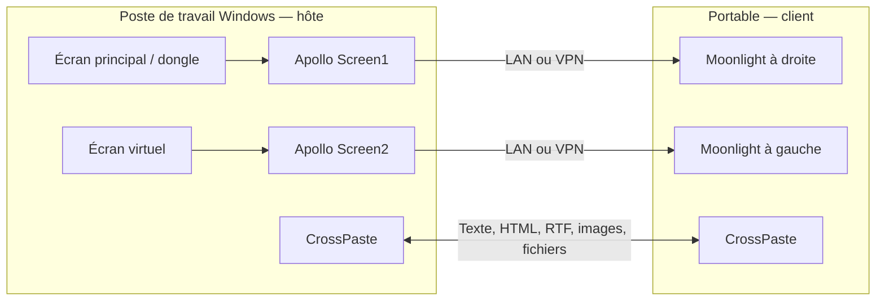

# Montage multi-écrans de référence

Les commandes ci-dessous s'exécutent depuis la racine du dépôt. [Retour à la présentation du kit](../README.md).
| Écran du client | Instance distante | Source sur le poste de travail | Flux | Affichage local |
|---|---|---|---|---|
| Portable à gauche, principal | Screen2 | Écran virtuel Apollo | 1920 × 1008 | Fenêtre |
| Écran externe à droite, secondaire, 2560 × 1080 | Screen1 | Écran principal physique ou dongle HDMI du GPU | 3200 × 1350 | Plein écran sans bordures |

Le facteur **1,25** concerne ici la résolution du flux : 2560 × 1,25 = 3200 et 1080 × 1,25 = 1350. On calcule une image plus grande, puis on l'affiche sur l'écran local. Ce n'est pas le réglage Windows « texte et applications à 125 % ».



Les deux instances montrent **le même bureau Windows étendu**. Elles ne créent pas deux utilisateurs ou deux sessions Windows isolées. Ce montage convient à une personne utilisant sa station ; deux collègues ne doivent pas piloter simultanément la même session en pensant disposer chacun d'un bureau indépendant.

## Démarrage rapide pour un collègue

**Client Windows simplifié :** télécharger `Apollo-Setup.cmd` dans les [Releases](https://github.com/softyoda/apollo-desktop-kit/releases), puis double-cliquer. Le fichier contient les scripts nécessaires, installe les applications dans le compte utilisateur, prépare le profil et crée **Apollo - Mes ecrans**. Inutile d'extraire un ZIP ou de conserver plusieurs scripts côte à côte. Lors de la première installation, renseigner les noms des hôtes Moonlight puis associer CrossPaste une fois ; les bureaux distants sont ouverts avant cette association pour voir le code de l'hôte sans autre outil distant. Les autorisations Windows éventuelles restent visibles.

Pour distribuer un fichier déjà personnalisé, avec les noms/résolutions de son équipe :

```powershell
.\windows\Build-SingleFile.ps1 -ProfilePath .\profile.local.json -OutFile .\Mon-bureau.cmd
```

L'application hôte et les associations Moonlight doivent déjà exister. Le kit ne peut pas deviner ni transférer leurs certificats. Les instructions détaillées ci-dessous restent disponibles pour configurer l'hôte ou adapter le montage.

1. Télécharger le ZIP de ce dépôt et l'extraire dans un dossier permanent.
2. Sur le **poste de travail Windows**, lancer `Install-host.cmd`, puis suivre [la configuration de l'hôte](windows-host.md). Les installateurs Apollo/Fleet restent interactifs pour les pilotes et l'élévation Windows.
3. Sur le **portable Windows**, lancer `Install-client.cmd`. Il installe Moonlight si nécessaire, CrossPaste, un profil détectant les écrans et un raccourci sur le bureau. Voir [le guide client](windows-client.md).
4. Associer une fois chaque instance dans Moonlight, puis associer les deux PC dans CrossPaste avec le code affiché par le PC destinataire.
5. Modifier les noms des hôtes dans le profil client pour qu'ils correspondent à ceux de Moonlight. Lancer ensuite **Apollo - My screens**.

Pour reprendre directement l'exemple ci-dessus depuis PowerShell :

```powershell
Copy-Item .\examples\two-screens.json .\profile.local.json
# Remplacer Screen1 et Screen2 dans ce fichier par les noms associés dans Moonlight.
powershell -NoProfile -ExecutionPolicy Bypass -File .\windows\Install-Client.ps1 -ProfilePath .\profile.local.json -PairClipboard
```

Conserver le dossier contenant `profile.local.json` : le raccourci le référence. Les téléchargements représentent plusieurs centaines de Mo. L'installateur client utilise le compte Windows courant, sans demander un mot de passe administrateur pour les archives portables.
